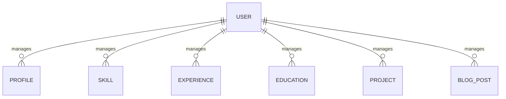

# DevFolio Backend

A RESTful API built with Django REST Framework to power a dynamic UI/UX designer portfolio, including profile management, skills, experience, education, projects, blog content, and dashboard administration.

## Tech Stack

- Python
- Django
- Django REST Framework (DRF)
- SQLite for local development; PostgreSQL recommended for production
- Django environment variables
- Token- or session-based authentication, depending on the configured authentication classes

## Features

- Dynamic profile and portfolio content management
- Skills, experience, education, and project management
- Blog posts and blog detail APIs
- Blog view counter
- Authentication and role-based permissions
- Protected dashboard management endpoints
- Pagination and filtering where configured
- API request throttling
- Django Admin integration
- Input validation through serializers

## Project Setup

### 1. Clone the repository

```bash
git clone https://github.com/YOUR_USERNAME/devfolio-backend.git
cd devfolio-backend
```

### 2. Create and activate a virtual environment

**Windows:**

```bash
python -m venv venv
venv\Scripts\activate
```

**macOS / Linux:**

```bash
python3 -m venv venv
source venv/bin/activate
```

### 3. Install dependencies

```bash
pip install -r requirements.txt
```

### 4. Configure environment variables

Create a `.env` file in the backend root directory.

```env
SECRET_KEY=replace-with-a-secure-secret-key
DEBUG=True
ALLOWED_HOSTS=127.0.0.1,localhost
DATABASE_URL=
FRONTEND_URL=http://localhost:5173
```

Ensure your Django settings actually read these variables. `DATABASE_URL` is optional if you configure SQLite directly.

Never commit your real secret key or production credentials.

### 5. Apply migrations

```bash
python manage.py makemigrations
python manage.py migrate
```

### 6. Create an administrator

```bash
python manage.py createsuperuser
```

### 7. Start the development server

```bash
python manage.py runserver
```

The API should be available at `http://127.0.0.1:8000/`.

The Django Admin panel is available at `http://127.0.0.1:8000/admin/`.

## Environment Variables

| Variable | Description | Example |
|---|---|---|
| `SECRET_KEY` | Django secret key | Secure random value |
| `DEBUG` | Enables development debugging | `True` |
| `ALLOWED_HOSTS` | Permitted hostnames | `localhost,127.0.0.1` |
| `DATABASE_URL` | Optional database connection URL | PostgreSQL connection URL |
| `FRONTEND_URL` | Frontend origin for CORS or related configuration | `http://localhost:5173` |

Add any other variables required by your actual settings, such as email credentials, deployment hosts, or media storage configuration.

## API Endpoints

Base URL: `http://127.0.0.1:8000/api/`

The table below is a documentation template. Replace endpoint paths and authentication levels with those defined in your actual URL configuration and permission classes.

| Resource | Method | Endpoint | Authentication |
|---|---|---|---|
| Profile | GET | `/api/profile/` | Public |
| Profile | PATCH | `/api/profile/` | Admin |
| Skills | GET | `/api/skills/` | Public |
| Skills | POST | `/api/skills/` | Admin |
| Skills | PATCH | `/api/skills/{id}/` | Admin |
| Skills | DELETE | `/api/skills/{id}/` | Admin |
| Experience | GET | `/api/experience/` | Public |
| Experience | POST | `/api/experience/` | Admin |
| Experience | PATCH | `/api/experience/{id}/` | Admin |
| Experience | DELETE | `/api/experience/{id}/` | Admin |
| Education | GET | `/api/education/` | Public |
| Education | POST | `/api/education/` | Admin |
| Education | PATCH | `/api/education/{id}/` | Admin |
| Education | DELETE | `/api/education/{id}/` | Admin |
| Projects | GET | `/api/projects/` | Public |
| Projects | POST | `/api/projects/` | Admin |
| Projects | PATCH | `/api/projects/{id}/` | Admin |
| Projects | DELETE | `/api/projects/{id}/` | Admin |
| Blog posts | GET | `/api/blog/` | Public |
| Blog detail | GET | `/api/blog/{slug}/` | Public |
| Blog posts | POST | `/api/blog/` | Admin |
| Blog posts | PATCH | `/api/blog/{slug}/` | Admin |
| Blog posts | DELETE | `/api/blog/{slug}/` | Admin |
| Authentication | POST | `/api/auth/login/` | Public |
| Authentication | POST | `/api/auth/logout/` | Authenticated |
| Dashboard | GET | `/api/dashboard/` | Admin |

**Important:** These are suggested paths, not verified routes. Document every additional endpoint in the project, including registration, token refresh, contact messages, pagination, and any custom dashboard actions. Remove routes that are not implemented.

Authentication labels must match the real API configuration. If using session authentication, document CSRF requirements. If using JWT, document the token format and refresh/logout behavior.

## Models and ERD Overview

The portfolio data model may include the following entities:

- **User:** Administrator account and authentication information.
- **Profile:** Designer biography, name, title, contact information, and social links.
- **Skill:** Skill name, category, proficiency, and display order.
- **Experience:** Company, position, employment dates, and responsibilities.
- **Education:** Institution, qualification, dates, and details.
- **Project:** Title, description, cover image, tools, and project links.
- **BlogPost:** Title, slug, content, cover image, publication status, and view count.

Adapt the list to your actual Django models. Use the following conceptual relationship diagram as a starting point:



This diagram is conceptual. If the models use a singleton profile, foreign keys, many-to-many relationships, or no ownership relationships, update the ERD to reflect the actual database schema.

## Blog View Counter Strategy

The blog detail endpoint should increment a post's view count when a qualifying detail request is received.

Recommended implementation:

- Increment the counter on the server, not in the frontend.
- Use an atomic database update, such as Django's `F()` expression, to reduce lost updates during concurrent requests.
- Keep the counter read-only in public serializers.
- Avoid incrementing views from list requests.
- Decide how repeat visits, authenticated users, bots, and preview requests should be handled.
- If implementing unique views, use a documented session, user, or time-window strategy.

A basic request counter measures detail requests, not necessarily unique human readers. Document the exact behavior implemented by this project.

## Permission Class

Use public read access for published portfolio and blog content, while restricting create, update, and delete operations to authorized administrators.

For custom permission classes, document:

- Which users can read each resource.
- Which users can create, update, or delete records.
- Whether permissions apply at the object level.
- How unauthenticated and unauthorised requests are handled.

The frontend hiding an edit button is not a security control. Enforce permissions on the backend.

## Throttling

Document the actual rates configured in Django REST Framework settings.

Example configuration:

```python
REST_FRAMEWORK = {
    "DEFAULT_THROTTLE_CLASSES": [
        "rest_framework.throttling.AnonRateThrottle",
        "rest_framework.throttling.UserRateThrottle",
    ],
    "DEFAULT_THROTTLE_RATES": {
        "anon": "100/hour",
        "user": "1000/hour",
    },
}
```

The values above are examples, not a claim about the current configuration. Replace them with the actual rates in `settings.py`. If login or contact endpoints have dedicated throttles, document those separately.

## Testing

Run the test suite using:

```bash
python manage.py test
```

Recommended coverage includes model validation, serializer validation, public API access, unauthorised write attempts, administrator access, view counter behavior, and throttling.

## Related Repositories

- **Frontend:** https://github.com/YOUR_USERNAME/devfolio-frontend
- **Postman Collection:** [Add your public Postman collection URL here]
- **Live API:** [Add your deployed backend URL here]

## License

Specify the license used by this repository, if applicable.


# DevFolio Frontend

A responsive portfolio website for a UI/UX designer, built with React and Vite. The application presents profile information, skills, work experience, education, projects, and blog content, with a protected dashboard for portfolio management.

## Screenshots

Add at least four screenshots, including the required light and dark homepage views.

### Home — Light Mode


### Home — Dark Mode


### Blog Listing


### Blog Detail


### Dashboard


Save your actual screenshots in the `screenshots/` directory. These Markdown image paths work when the files are committed to the repository. Do not leave placeholder images in the final submission.

## Tech Stack

- React
- Vite
- JavaScript (ES6+)
- React Router
- CSS3 and responsive layouts
- REST API integration with Django REST Framework
- Fetch API or Axios, depending on the implementation
- Context API or another state-management approach, if used

List only the libraries and tools actually used by your project.

## Features

- Responsive portfolio homepage
- Profile, skills, experience, and education sections
- Project showcase
- Blog listing and blog detail pages
- Light and dark themes
- Protected dashboard routes
- Portfolio content management through the backend API
- Reusable UI components
- Loading, error, and empty states where implemented

## Getting Started

### Prerequisites

- Node.js (LTS recommended)
- npm
- Running DevFolio backend API

### 1. Clone the repository

```bash
git clone https://github.com/YOUR_USERNAME/devfolio-frontend.git
cd devfolio-frontend
```

### 2. Install dependencies

```bash
npm install
```

### 3. Configure environment variables

Create a `.env` file in the frontend root directory.

```env
VITE_API_BASE_URL=http://127.0.0.1:8000/api
```

Use the actual API base path configured by your backend. Vite exposes variables prefixed with `VITE_` to client-side code, so never place secrets or private API credentials in these variables.

### 4. Start the development server

```bash
npm run dev
```

Open the local URL printed by Vite, usually `http://localhost:5173/`.

### 5. Build for production

```bash
npm run build
```

To preview the production build locally:

```bash
npm run preview
```

## Application Routes

Update the paths and access requirements below to match your React Router configuration.

| Route | Page | Access |
|---|---|---|
| `/` | Home | Public |
| `/projects` | Projects listing | Public |
| `/projects/:slug` | Project details, if implemented | Public |
| `/blog` | Blog listing | Public |
| `/blog/:slug` | Blog detail | Public |
| `/login` | Administrator login | Public |
| `/dashboard` | Dashboard overview | Protected |
| `/dashboard/profile` | Profile management | Protected |
| `/dashboard/skills` | Skills management | Protected |
| `/dashboard/experience` | Experience management | Protected |
| `/dashboard/education` | Education management | Protected |
| `/dashboard/projects` | Project management | Protected |
| `/dashboard/blog` | Blog management | Protected |

Protected routes should require an authenticated user and redirect unauthorized visitors appropriately. Backend permissions must independently enforce access control.

## Design Direction

**Selected direction: [A / B / C / D — replace with your chosen direction]**

Describe the selected visual approach, its intended audience, and the reasoning behind the interface.

For example, a clean, product-focused editorial portfolio could use:

- Strong typography and clear information hierarchy
- Generous whitespace
- Consistent spacing and alignment
- Reusable cards and form controls
- Accessible color contrast
- A cohesive light and dark theme
- Responsive layouts across desktop, tablet, and mobile

Use this description only if it accurately reflects the implemented design.

## Design Tokens

The following is an example token set. Replace the values with your actual CSS variables and design decisions.

| Token | Light Theme | Dark Theme |
|---|---|---|
| Primary | `#2563EB` | `#60A5FA` |
| Background | `#FFFFFF` | `#0B0F19` |
| Surface | `#F8FAFC` | `#151B2B` |
| Text | `#111827` | `#F9FAFB` |
| Muted text | `#64748B` | `#9CA3AF` |
| Border | `#E2E8F0` | `#293244` |

| Token | Value |
|---|---|
| Font family | Replace with the actual font |
| Base font size | `16px` |
| Spacing scale | `4, 8, 12, 16, 24, 32, 48, 64px` |
| Small radius | `4px` |
| Medium radius | `8px` |
| Large radius | `16px` |
| Container width | Replace with your actual maximum width |

Example CSS custom properties:

```css
:root {
  --color-primary: #2563eb;
  --color-background: #ffffff;
  --color-surface: #f8fafc;
  --color-text: #111827;
  --color-muted: #64748b;
  --color-border: #e2e8f0;

  --font-family: sans-serif;

  --space-1: 4px;
  --space-2: 8px;
  --space-3: 12px;
  --space-4: 16px;
  --space-6: 24px;
  --space-8: 32px;

  --radius-sm: 4px;
  --radius-md: 8px;
  --radius-lg: 16px;
}

[data-theme="dark"] {
  --color-primary: #60a5fa;
  --color-background: #0b0f19;
  --color-surface: #151b2b;
  --color-text: #f9fafb;
  --color-muted: #9ca3af;
  --color-border: #293244;
}
```

Connect these variables to the components and theme-switching implementation used by the application.

## Folder Structure

Example structure:

```text
devfolio-frontend/
├── public/
├── screenshots/
│   ├── home-light.png
│   ├── home-dark.png
│   ├── blog-list.png
│   ├── blog-detail.png
│   └── dashboard.png
├── src/
│   ├── assets/
│   ├── components/
│   │   ├── Navbar.jsx
│   │   ├── Footer.jsx
│   │   ├── ProjectCard.jsx
│   │   ├── BlogCard.jsx
│   │   ├── Pagination.jsx
│   │   └── ProtectedRoute.jsx
│   ├── pages/
│   ├── dashboard/
│   │   ├── DashboardHome.jsx
│   │   ├── ProfileManagement.jsx
│   │   ├── SkillsManagement.jsx
│   │   ├── ExperienceManagement.jsx
│   │   ├── EducationManagement.jsx
│   │   └── ProjectsManagement.jsx
│   ├── services/
│   ├── context/
│   ├── hooks/
│   ├── styles/
│   │   └── variables.css
│   ├── App.jsx
│   └── main.jsx
├── .env.example
├── .gitignore
├── index.html
├── package.json
└── vite.config.js
```

Adjust this tree to reflect your actual files and directories.

## Accessibility and Responsiveness

The interface should use semantic HTML, keyboard-accessible navigation, visible focus states, meaningful alternative text, and sufficient color contrast. Test responsive behavior across mobile, tablet, and desktop screen sizes.

Document accessibility features that have actually been implemented and tested.

## What I Would Improve With More Time

- Add comprehensive automated component and end-to-end tests.
- Improve accessibility through keyboard and screen-reader testing.
- Add stronger form validation and more helpful error messages.
- Optimize image delivery and loading performance.
- Improve SEO and social sharing metadata for project and blog pages.
- Add richer search, filtering, and pagination if needed.
- Refine analytics and blog view-count reporting.
- Improve deployment monitoring and error logging.

## Related Projects

- **Backend repository:** https://github.com/YOUR_USERNAME/devfolio-backend
- **Live website:** [Add your deployed frontend URL here]
- **API documentation:** [Add your deployed API or API documentation URL here]

## License

Specify the license used by this repository, if applicable.
